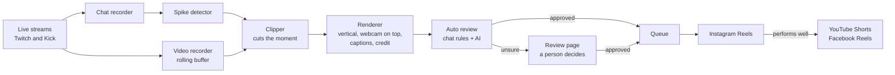

# Getting started with Peakreel

This guide takes you from an empty machine to a Peakreel that records live streams, cuts the best moments into vertical clips, and posts them on its own.
It explains what each part does, what you need to set up once, and how to run it day to day.
The milestone documents (`docs/m*.md`) go deeper into each part; this guide links to them where it matters.

## What Peakreel does

Peakreel watches live streams on Twitch and Kick.
When a stream's chat suddenly gets much busier than usual (a "spike"), something worth seeing probably just happened.
Peakreel cuts that moment out of the video it has been recording, turns it into a captioned 1080x1920 vertical clip, and decides (with your rules and a free AI model) whether it is good enough to post.
Approved clips are posted to Instagram Reels first; the ones that do well there are promoted to YouTube Shorts and Facebook Page Reels.



Two processes do all the work:

| Process | Command | What it does |
| --- | --- | --- |
| Pipeline | `peakreel run start` | Finds streams, records chat and video, detects spikes, cuts, renders and captions clips. This is the CPU and GPU heavy part. |
| Review app | `peakreel review` | Serves the review page, runs auto review, posts the queue, reads post statistics and promotes good posts. Light on the machine. |

They are independent.
You can pause recording (the pipeline) and the review app keeps posting what is already queued.

## Requirements

| Need | Why | Notes |
| --- | --- | --- |
| Windows 10 or 11 (Linux works too) | Everything is tested on Windows 11 | Commands below use Windows paths |
| [uv](https://docs.astral.sh/uv/) | Installs Python and every dependency | Never use `pip` in this project |
| ffmpeg and ffprobe | Cutting, rendering, audio analysis | `scoop install ffmpeg`, or set `tools.ffmpeg` in `config.local.yaml` |
| An NVIDIA graphics card (recommended) | Videos are encoded on the GPU (NVENC) | Without one, Peakreel falls back to the CPU, which runs hot (see [m5-renderer.md](m5-renderer.md)) |
| A fast, stable internet connection | Every followed stream is downloaded live | About 4 Mbit/s per stream at 720p; 22 streams need about 90 Mbit/s |
| Disk space | Clips, the video buffer, the database | Keep at least 20 GB free; retention deletes old files on its own |
| [Tailscale](https://tailscale.com/) (optional) | Open the review page on your phone; receive Kick chat webhooks | `tailscale serve` for the page, `tailscale funnel` for Kick |
| A correct clock | Chat and video are matched by time | `doctor` checks it; fix with `w32tm /resync` as administrator |

## 1. Install

```
git clone https://github.com/liamarguedas/peakreel.git
cd peakreel
uv sync
uv run peakreel doctor
```

`doctor` prints one PASS or FAIL line per check: Python, clock, ffmpeg, ffprobe, streamlink, the data folder and the database.
Fix every FAIL before going further.

Then download the models and word lists Peakreel uses offline:

```
uv run peakreel captions download    # the Whisper speech model for captions
uv run peakreel safety download      # blocked-word lists for the safety flags
```

## 2. Configuration files

| File | In git | Use |
| --- | --- | --- |
| `config.yaml` | Yes | Portable defaults, with a comment on every setting. Read it once. |
| `config.local.yaml` | No | Your machine's values, deep-merged over `config.yaml`. Put everything personal here. |
| `blocklist.yaml` | Yes | Streamers who must never be clipped. Checked before any clip is written or kept. |

Secrets (API keys, tokens, passwords) never go in any of these files.
Every `setup`, `login` and `connect` command below stores them in the Windows Credential Manager.

A typical `config.local.yaml`:

```yaml
tools:
  ffmpeg: C:/path/to/ffmpeg.exe
  ffprobe: C:/path/to/ffprobe.exe

discover:
  enabled: true
  platforms: [twitch, kick]
  max_channels: 22            # streams recorded at once; limited by your bandwidth and CPU

publish:
  modes: {youtube: public, instagram: public, facebook: public}
  platforms: [instagram]      # approving a clip posts it to Instagram
  promote_to: [youtube, facebook]   # ... and good performers go here later

review:
  auto:
    mode: "on"                # let auto review approve and reject (quote "on": YAML reads on as true)
```

### Which streams are followed

Two ways, and they combine:

- **Discovery** (`discover:`): Peakreel follows the top live streams of a category (by default Grand Theft Auto VI) on Twitch and Kick, starts recording new ones and drops those that fall out of the top.
  `language_max` caps channels per language; `exclude` skips specific ones.
  Preview what it would pick right now with `uv run peakreel discover preview`.
  Details: [discovery.md](discovery.md).
- **Fixed channels** (`channels:`): streams you always want, each with its `language` and a `credit` line.
  Details: [m0-setup.md](m0-setup.md).

### Posting accounts

`publish.accounts` in `config.yaml` lists your posting accounts.
Each account has an `id` (like `en`, `es2`), the `languages` it posts, its `platforms`, a `credit` template and its `handles`.
A clip goes to an account of its language; with several accounts per language, it goes to the one that posted least in the last 24 hours.
Extra Instagram accounts (without a Facebook Page) are listed with `platforms: [instagram]`.

Each platform has a `daily_cap` and `min_spacing_min` under `publish:`.
New Instagram accounts that post a lot get blocked by Meta's anti-spam: start around 25 posts a day, at least 5 minutes apart, and raise it slowly over weeks.

## 3. Connect the services

Do these once.
Each command asks for its secret at a hidden prompt; run them in a normal terminal (PowerShell or cmd), since hidden prompts do not work through tools that cannot type into them.

### Twitch (required)

1. Create an application at [dev.twitch.tv/console](https://dev.twitch.tv/console) (any OAuth redirect such as `http://localhost`).
2. `uv run peakreel twitch login` and paste the client ID and secret.
3. `uv run peakreel twitch status` confirms Twitch accepts them.

Twitch credentials are used for stream status, discovery and VOD links.

### Kick (optional)

Kick chat arrives through official webhooks, so Kick needs a public HTTPS address (Tailscale Funnel works).
Follow [kick.md](kick.md): `uv run peakreel kick setup`, then `uv run peakreel kick status`.

### Review page password (required before using it from another device)

```
uv run peakreel review password
```

The page listens on `127.0.0.1:8765`.
To open it on your phone, add your Tailscale host name to `review.public_hosts` and run `tailscale serve --bg 8765`.
Details: [m7-supervisor-review.md](m7-supervisor-review.md).

### AI for auto review and titles (recommended)

Auto review watches each clip with a free video model, scores it from 1 to 10, and writes the title, description and hashtags in the account's language.
Models are tried in the order of `review.auto.gemini_models`; a model out of quota is skipped until its quota resets, then used again.

1. **Gemini (free tier):** create a key at [aistudio.google.com/apikey](https://aistudio.google.com/apikey), then `uv run peakreel gemini setup`.
   The free tier allows about 20 clips a day on the best models and 500 on Flash Lite.
   Test one clip with `uv run peakreel gemini judge <clip.mp4>`.
2. **OpenRouter (when Gemini runs out):** create a key at [openrouter.ai](https://openrouter.ai), then `uv run peakreel openrouter setup`.
   OpenRouter only accepts video when the account has at least $1 of credit **and** the key's own credit limit allows at least $1 (Settings, API Keys, Credit limit).
   Free models still cost nothing; the credit only has to be there.
   You get 50 free requests a day, or 1,000 a day once the account has bought $10 in total.

Without any AI, clips get a title from the chat and a person approves them on the review page.
Details: [auto-review.md](auto-review.md).

### Instagram and Facebook

You need a Meta developer app and, per language, an Instagram professional account (Creator or Business).
There are two ways to connect an Instagram account:

| Way | When | Command |
| --- | --- | --- |
| Through a Facebook Page | The Instagram account is linked to a Page (also gives Facebook Reels) | `uv run peakreel meta setup` once, then `uv run peakreel meta login --account <id>` |
| Unified login (no Page) | Extra Instagram accounts, or apps created since late October 2026 | `uv run peakreel instagram connect --account <id>` |

For **Unified login**:

1. Make the Instagram account a professional account (in the Instagram app: Settings, Account type and tools).
2. In the Meta app dashboard, open App roles, Instagram testers, and add the account.
3. Logged into instagram.com **as that account**, accept the invite at instagram.com/accounts/manage_access (Tester invites).
4. In the dashboard, generate the account's token.
   The token belongs to whichever Instagram account logs in at the popup, not to the row you clicked: use a private window, or log out of other accounts first.
5. `uv run peakreel instagram connect --account <id>` and paste the token.
   A token for an account that is already connected under another id is refused.

Check everything with `uv run peakreel meta status`.
Details and error messages: [m12-meta.md](m12-meta.md).

### YouTube (optional)

Create a Google Cloud project with the YouTube Data API and an OAuth client, then `uv run peakreel youtube setup` and `uv run peakreel youtube login --account <id>`.
The free API quota allows about 100 uploads a day per project.
Details: [m10-youtube.md](m10-youtube.md).

### Notifications (optional)

`notify.desktop` shows a Windows toast per new clip.
Set `notify.ntfy_topic` to a long random string and subscribe to it in the ntfy app for phone pushes.

## 4. Start it

```
uv run peakreel run start --detach      # the pipeline, in the background
uv run peakreel review --detach         # the review page and the posting loops
```

Open [http://127.0.0.1:8765/](http://127.0.0.1:8765/) and log in.

`--detach` confirms the process is still alive a few seconds later, so a start-up failure (a port in use, a channel already recorded by another process) is reported at once.
Background processes write only to `data/logs/peakreel.jsonl`.

To start everything at logon, put both commands (and any `tailscale serve` or `funnel` lines you use) in a `.cmd` file and run it from a Task Scheduler task "At log on".

To stop:

```
uv run peakreel run stop                # finishes clips in progress, then stops
```

The review app holds no state: end its process to stop it, start it again any time.

## 5. The review page

The header shows the machine and the pipeline at a glance:

| Item | Meaning |
| --- | --- |
| **Pause recording / Start recording** | Stops or starts the pipeline. Paused, nothing is recorded or rendered, so the CPU and GPU rest; the queue keeps posting. |
| `N/M channels live` | Streams being recorded; hover for each one's video age and chat rate |
| `AI: N of M models out` | Models out of quota and when each comes back (hover) |
| CPU, RAM, GPU, download | The machine's load, refreshed every 30 s |
| `updated hh:mm` | Last pipeline report; amber when older than 2 minutes (the pipeline stopped or hung) |
| Amber warnings | `disk low`, `memory high`, `captions behind`, `clips piling up` (see the README runbook) |

The page has five sections, some with small tabs under them:

| Section | Tabs | What you do there |
| --- | --- | --- |
| **Home** | Overview, Activity | Problems of the last hour first, today's totals, each language's Instagram accounts against their daily caps, the latest posts and recent activity. Activity is the full log, in blocks. |
| **Review** | To review, Check AI | Clips the AI was unsure about: watch, then Approve or Reject (the reason teaches the AI your taste). Check AI: clips the AI rejected, to spot-check. |
| **Pipeline** | Board | A board from AI checking to Waiting for you, Queued, Uploading and Posted, with tags for the account, streamer, language and who approved. |
| **Accounts** | Accounts, Stats | Each Instagram account's posts in the last 24 hours against its cap, and the history per day (never deleted). Stats: views, likes and comments. |
| **Library** | Posted, Approved, Rejected | Posted: every Instagram post, newest first. Approved and Rejected: clips by language and streamer. |

## 6. What happens to a clip

1. **Spike.** Chat in a 10-second window goes well above its usual rate (median plus several deviations), from many different people.
   Raids, sub trains and copy-paste spam are filtered out.
2. **Cut.** The clip runs from 20 seconds before the spike to 10 seconds after it (`clip.pre_roll_s`, `post_roll_s`), cut from the rolling video buffer.
   At most `clip.max_per_hour` clips per channel per hour, except very high scores.
3. **Render.** If a webcam is found, the clip becomes two stacked parts: the webcam on top, the zoomed gameplay below.
   Otherwise the full frame is centred on a blurred copy of itself.
   The channel name, an AI title band and burned-in captions are added; audio is normalised to -14 LUFS.
4. **Safety and duplicates.** Music (copyright risk) is flagged; a clip that is the same moment as one from another channel is marked duplicate.
5. **Auto review.** Chat rules reject clips nobody reacted to together.
   The AI then watches the clip: a score at or above `ai_approve` approves it, at or below `ai_reject` rejects it, anything between waits for a person.
   Sexual content is always rejected.
   Without an AI verdict, only a person can approve.
6. **Post.** Approved clips are posted to Instagram on the least-used account of their language, newest first, respecting each account's spacing and daily cap.
   A clip still waiting `publish.max_wait_h` hours after it was recorded is dropped as stale.
   If Instagram refuses a post for posting too often, that account pauses for 6 hours.
7. **Promote.** Statistics are read 3, 12, 24 and 72 hours after posting.
   A post whose likes plus three times its comments beat its language's median is promoted once to YouTube and Facebook.

## 7. Where things are

| Path | Contents |
| --- | --- |
| `data/peakreel.db` | SQLite: clips, publications, statistics. The single source of truth. |
| `data/outbox/<channel>/` | Clips: horizontal `.mp4`, `.vertical.mp4`, thumbnail, captions, sidecar `.json` |
| `data/buffer/` | The rolling video buffer (last few minutes per channel) |
| `data/chat/` | Chat logs (JSONL), kept 90 days |
| `data/logs/peakreel.jsonl` | The log, rotated at 10 MB |
| `data/run/status.json` | The pipeline's health report, rewritten every 30 s |
| `data/publish/` | Export packages for platforms posted by hand |

Retention deletes rejected clips after 2 days, unreviewed ones after 7 and posted ones a day after posting; the database rows and statistics stay.
`uv run peakreel cleanup --dry-run` shows what it would delete now.

## 8. Useful commands

| Command | Use |
| --- | --- |
| `peakreel doctor` | Check the environment |
| `peakreel discover preview` | Which streams discovery would follow right now |
| `peakreel publish status` | Every post with its state, account and link |
| `peakreel publish preview <clip id>` | The text each platform would get for a clip (ids are on the review page) |
| `peakreel meta status` | Instagram and Facebook accounts and tokens |
| `peakreel youtube status` | YouTube channels and tokens |
| `peakreel stats` | Post performance in the terminal |
| `peakreel review evaluate` | How auto review agrees with your own decisions |
| `peakreel render <clip>` | Render a clip again by hand |
| `peakreel cleanup` | Apply retention now |

Add `--help` to any command for its options.

## 9. Troubleshooting

| Symptom | Cause | Fix |
| --- | --- | --- |
| CPU at 100% and the machine hot while clipping | Encoding on the CPU (no NVENC), captions on the CPU, too many streams | Check the GPU is NVIDIA with a current driver; lower `discover.max_channels`; pause recording from the page |
| Clips posted without a proper title | Every AI model is out of quota | Add an OpenRouter key with credit (see above); the `AI:` pill shows when each model returns |
| OpenRouter HTTP 402 "requires at least $1.00 in balance for video" | No credit, or the key's credit limit is $0 | Add credit and raise the key's limit to at least $1 |
| Instagram error "limit how often" (code 368) | Meta's anti-spam | The account pauses 6 hours on its own; lower its `daily_cap` or widen `min_spacing_min` |
| `instagram connect` says the token is for another account | The token was generated while logged into a different Instagram account | Generate it again in a private window, logged in as the right account |
| `doctor` fails the clock check | The PC clock drifted more than 2 s | `w32tm /resync` as administrator |
| `updated` pill amber, channels missing | The pipeline stopped or crashed | Look at the end of `data/logs/peakreel.jsonl`, then **Start recording** |
| Webcam not on top, clip shows a blurred frame instead | No stable face found in a webcam-sized box | Expected for IRL and full-camera streams; see [m5-renderer.md](m5-renderer.md) for how detection works |
| "database is locked" in the log | Two processes wrote at once for more than 30 s | Usually transient; report it if it repeats |

## 10. Rules to keep

- **Credit and removal.** Every clip carries the streamer's name and a link to their channel.
  When a streamer asks for removal, follow "A streamer asks for removal" in the [README](../README.md) at once: blocklist first, then delete posted clips.
- **Secrets.** Keys and tokens live only in the credential store.
  Delete any file you used to paste tokens from once they are connected.
- **New accounts.** Grow posting volume slowly; one blocked account costs more than a day of slower posting.
- **Nudity.** GTA has it; the AI rejects sexual content, but check the Check AI tab now and then.

## Further reading

| Topic | Document |
| --- | --- |
| Configuration basics | [m0-setup.md](m0-setup.md) |
| Chat recording | [m1-chat-ingest.md](m1-chat-ingest.md) |
| Spike detection | [m2-detector.md](m2-detector.md) |
| Video recording | [m3-recorder.md](m3-recorder.md) |
| Clipping | [m4-clipper.md](m4-clipper.md) |
| Rendering, webcam layout, encoder | [m5-renderer.md](m5-renderer.md) |
| Captions | [m6-captions.md](m6-captions.md) |
| Running unattended, review page | [m7-supervisor-review.md](m7-supervisor-review.md) |
| Safety flags and duplicates | [m7a-safety-dedupe.md](m7a-safety-dedupe.md) |
| Publishing and post text | [m9-publisher.md](m9-publisher.md) |
| YouTube | [m10-youtube.md](m10-youtube.md) |
| Instagram and Facebook | [m12-meta.md](m12-meta.md) |
| Discovery | [discovery.md](discovery.md) |
| Kick | [kick.md](kick.md) |
| Auto review | [auto-review.md](auto-review.md) |
| Platform rules and limits | [platforms.md](platforms.md) |
